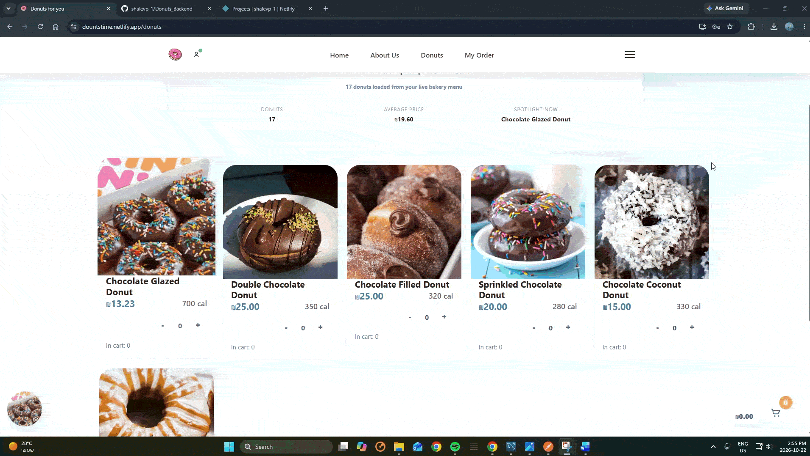
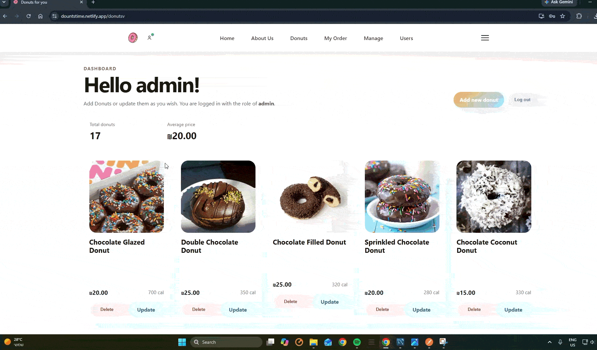

# Donuts for You — Frontend

The React and TypeScript storefront for **Donuts for You**, a full-stack donut shop. Browse the catalog, manage a cart, place orders, and access member or admin features.

**Live site:** [dountstime.netlify.app](https://dountstime.netlify.app/)

> The API runs on Render and may take a few seconds to respond after a period of inactivity.

## Product demos

### Buying donuts



### Updating a donut price as an admin



## Features

- Browse donuts and view product details, including price, ingredients, and calories
- Add and remove items from a persistent cart
- Register, sign in, and sign out
- Check out and view an order summary
- View rewards points, coupons, and purchase history
- Use admin pages to manage donuts and users

## Built with

React 18, TypeScript, React Router, Axios, Bootstrap, and CSS. The project was bootstrapped with Create React App.

## Run locally

Requirements: Node.js and npm.

```bash
npm install
npm start
```

The development server opens at `http://localhost:3000`. The backend and MySQL database must also be configured and running for API-backed features. See the [backend README](../backend/README.md) for setup instructions.

Create a production build with:

```bash
npm run build
```

## Deployment

The frontend is deployed on Netlify. In production, Netlify routes `/api/*` requests to the backend; see the backend README for the API and deployment configuration.
